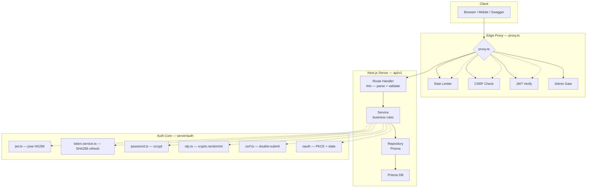
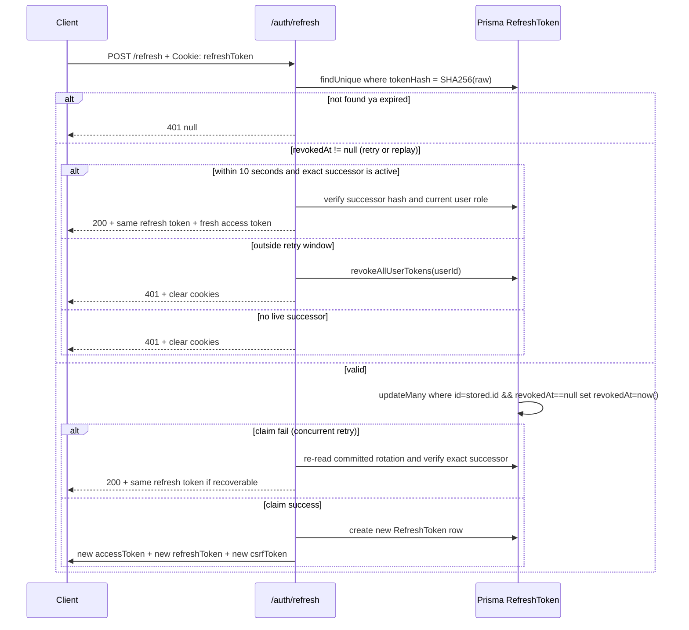
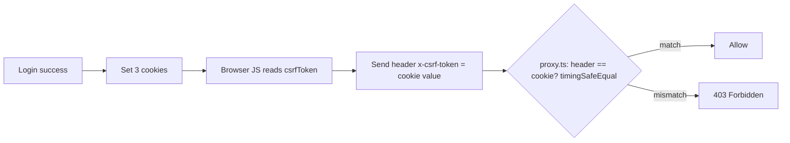
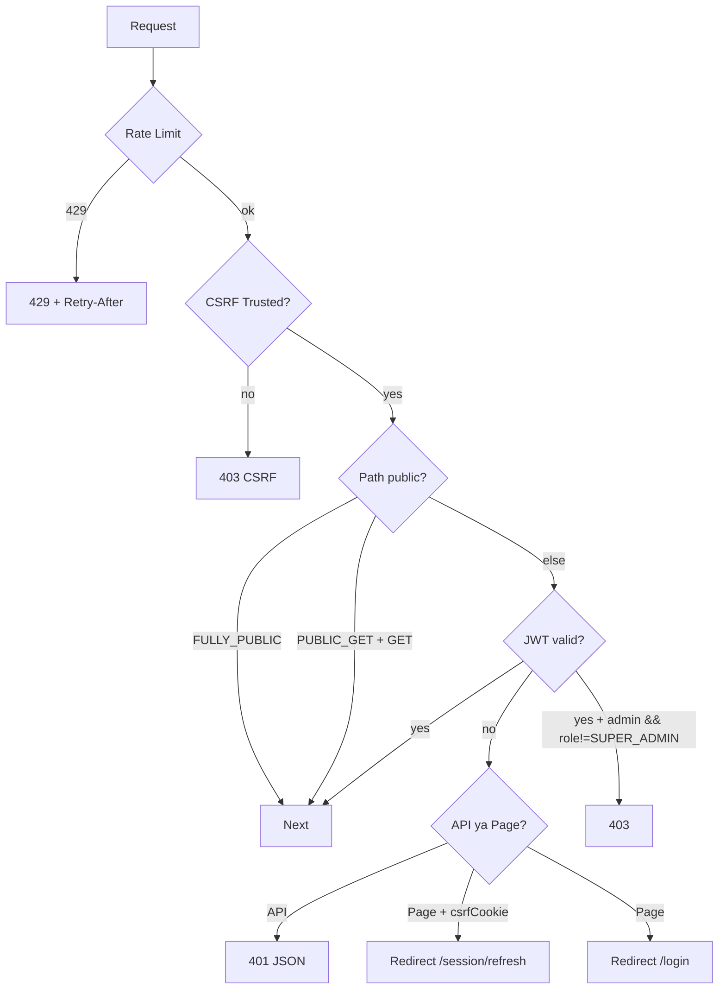
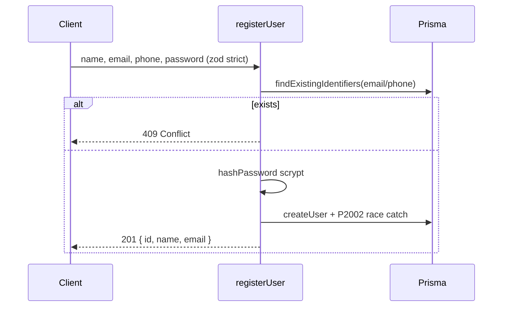
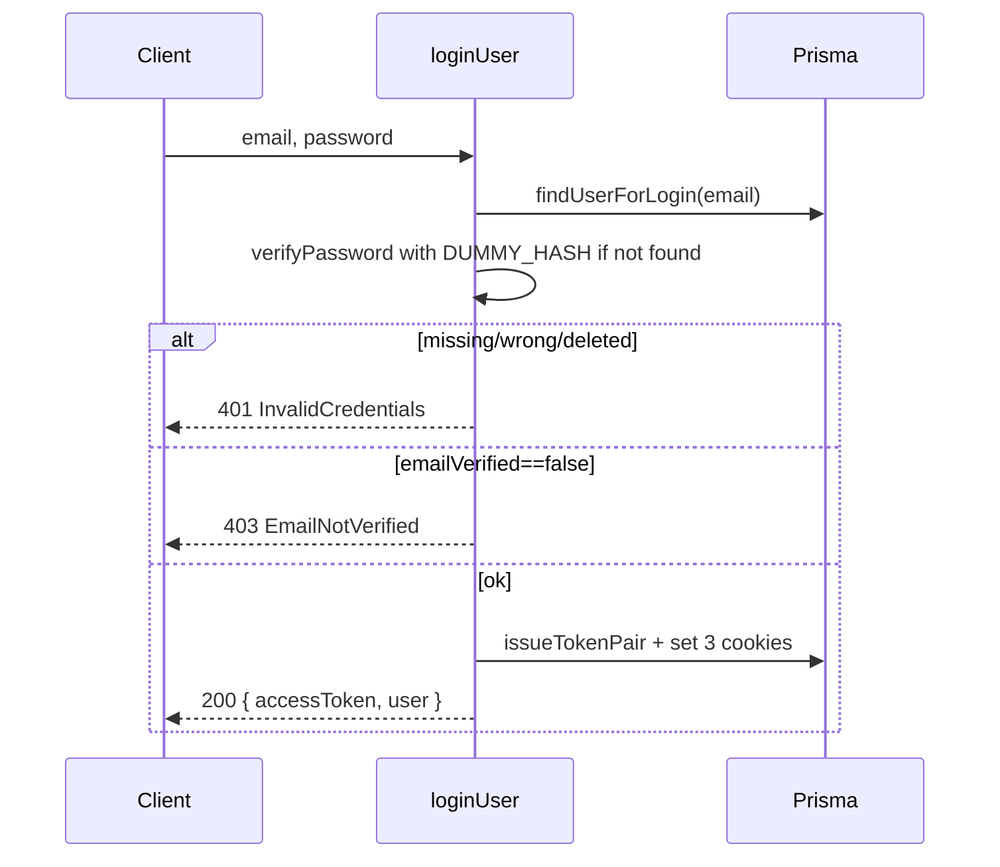
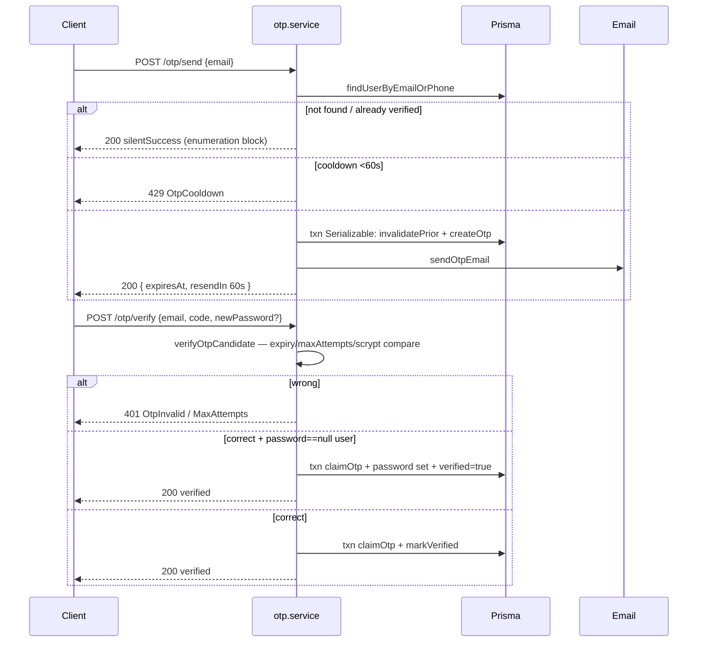
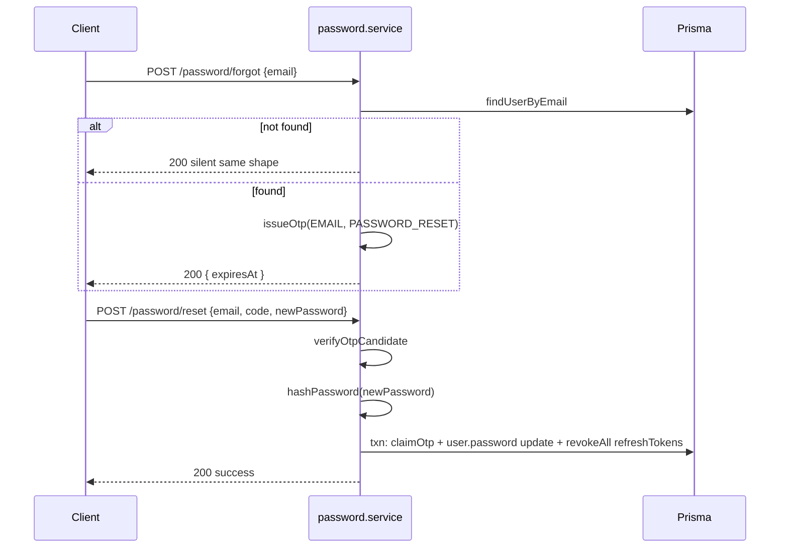
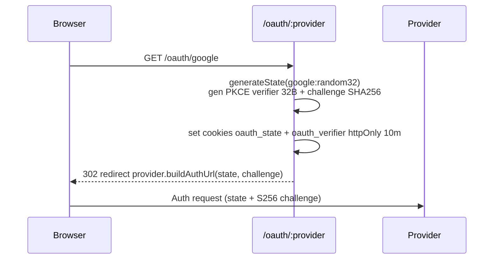
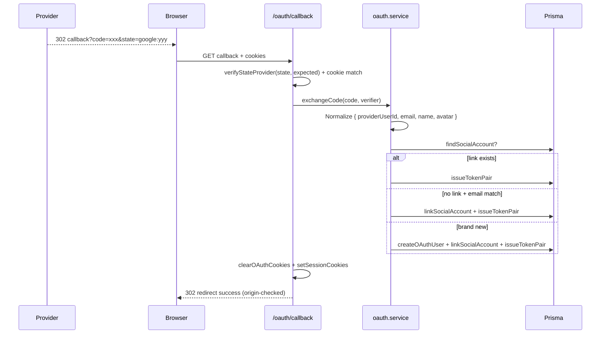

# Nikharta Roop — Auth System (Full Guide)

> **Language note:** Ye docs Hinglish me hai taaki WhatsLang wali feel aaye — technical terms English me rakhe hain, explanation Hinglish me.
> Last updated: 2026-10-13 | Stack: Next.js 16 + jose + scrypt + Prisma + Upstash

---

## 1. TL;DR — Auth kaise kaam karta hai?

Nikharta Roop me auth **JWT Access Token (15 min, stateless) + Opaque Refresh Token (7 din, DB-backed, rotating)** pattern pe bana hai. Iske saath **CSRF double-submit**, **scrypt password hashing**, **OTP (email/phone)**, aur **OAuth (Google/Apple/Facebook) with PKCE + provider-bound state** add hai. Har cheez `src/server/auth/` aur `src/server/modules/auth|otp|password` me isolated hai, aur `src/proxy.ts` (Edge middleware) har request pe gatekeeper ka kaam karta hai.

---

## 2. High-Level Architecture



### Core Files ka Map

| File | Kaam |
|------|------|
| `src/server/auth/jwt.ts` | `jose` se `SignJWT` / `jwtVerify` — HS256, issuer `salon-app`, audience `salon-app-client` |
| `src/server/auth/token.service.ts` | `issueTokenPair` + `rotateRefreshToken` + `hashRefreshToken (SHA256)` |
| `src/server/auth/cookies.ts` | `setSessionCookies` / `clearSessionCookies` — 3 cookies set karta hai |
| `src/server/auth/csrf.ts` | `generateCsrfToken` + `isMutationRequestTrusted` (double-submit) |
| `src/server/auth/session.ts` | `getAuthContext` — Bearer pehle, phir cookie se token nikal ke verify |
| `src/server/auth/password.ts` | `scrypt` hashing — N=2^17, r=8, p=1, 32 random salt |
| `src/server/auth/otp.ts` | 6-digit OTP — `crypto.randomInt`, TTL 10 min, cooldown 60s, max 5 attempts |
| `src/server/auth/auth.constants.ts` | TTL & cookie names |
| `src/proxy.ts` | Edge middleware — rate limit, CSRF, JWT, role gate |
| `src/lib/rate-limit.ts` | Upstash sliding window + in-memory fallback |
| `prisma/schema.prisma` | `User`, `Otp`, `RefreshToken`, `SocialAccount` |

---

## 3. Tokens — 2 Token System

### 3.1 Constants

```ts
// src/server/auth/auth.constants.ts
ACCESS_COOKIE_NAME  = "accessToken"    // httpOnly, lax, path="/",  maxAge 15*60
REFRESH_COOKIE_NAME = "refreshToken"   // httpOnly, lax, path="/api/v1/auth", maxAge 7d
CSRF_COOKIE_NAME    = "csrfToken"      // readable by JS (!httpOnly), lax, path="/", maxAge 7d
ACCESS_TOKEN_TTL    = "15m"            // jose me
REFRESH_TOKEN_TTL   = 7 * 24 * 60 * 60 // 7 din
JWT_SECRET          // >= 32 bytes, nahi to app boot pe throw
```

### 3.2 Access Token (JWT)

- **Algo:** `HS256` only (pin kiya hua — algorithm confusion attack band)
- **Payload:** Sirf `{ sub: userId, role: "USER" | "SUPER_ADMIN" }` — koi PII nahi leak hota
- **Claims:** `iss: "salon-app"`, `aud: "salon-app-client"`, `iat`, `exp: 15m`
- **Verify:** `jwtVerify(token, secret, { algorithms: ["HS256"], issuer, audience })` + role whitelist check
- **Lib choice:** `jose` isliye kyunki ye Node + Edge dono me chalta hai (middleware compatible)

### 3.3 Refresh Token (Opaque)

- **Generate:** `randomBytes(40).toString("base64url")` — 40 bytes random, unpredictable
- **Store:** DB me sirf `SHA256(token)` hash store hota hai — leak hone pe bhi usable token nahi milta
- **Model:** `RefreshToken { id, userId, tokenHash @unique, userAgent, ipAddress, expiresAt, revokedAt }`
- **Rotation:** Har `POST /api/v1/auth/refresh` pe purana token `revokedAt` set + naya pair issue
- **Retry and replay:** Within 10 seconds, a rotated token can recover only its exact, still-active successor. Later reuse revokes all live refresh sessions. Logout, password changes, and deleted accounts cannot be recovered.



---

## 4. Password Hashing — scrypt

```ts
// src/server/auth/password.ts
// Format: "scrypt$N=131072,r=8,p=1$salt_base64url$hash_base64url"
salt = randomBytes(16)
derivedKey = scrypt(password, salt, { N: 2^17, r: 8, p: 1, keyLen: 64, maxmem: 256MB })
```

- **Verify:** `timingSafeEqual` se compare — timing leak nahi
- **Self-describing format:** Har hash me params stored, isliye future me N/r/p change karne pe purane hash abhi bhi verify honge
- **Malformed hash:** `false` return, throw nahi — caller ek hi "invalid credentials" path pe rahega

---

## 5. CSRF — Double-Submit Cookie



**Rules (`isMutationRequestTrusted`):**

- GET/HEAD/OPTIONS — no CSRF
- `Authorization: Bearer ...` — no CSRF (bearer auto-attach nahi hota)
- `PUBLIC_MUTATION_PATHS` (/register, /login, /otp/*, /password/*) — no CSRF
- `sec-fetch-site: cross-site/same-site` — Block
- `origin !== APP_ORIGIN` — Block
- `POST` + `next-action` + origin match + non-API — Pass (Server Action)
- Cookie auth + mutation — double-submit `x-csrf-token` must equal `csrfToken` cookie (constant-time)
- Apple callback cross-site form POST — exempted, OAuth state se verified
- Token gen: `randomBytes(32).base64url()`

---

## 6. Proxy (Edge Middleware) — Har Request ka Gatekeeper



**Public Paths:** FULLY_PUBLIC = /auth/*, /health, /coupons/validate, /cron/*, /oauth/* | PUBLIC_GET = /salons, /services/categories, /products/categories, /blog/* | PUBLIC_GET_PATTERNS (regex) = /salons/{slug}, /salons/{slug}/services, /products/{id}/reviews etc

**Rate Limiters (Upstash sliding window, dev in-memory Map):**

| Limiter | Limit | Prefix | Kaha lagta hai |
|---------|-------|--------|----------------|
| authLimiter | 10 / 1m | ratelimit:auth | /api/v1/auth/* |
| standardLimiter | 60 / 1m | ratelimit:standard | Unauth non-auth APIs |
| authenticatedLimiter | 120 / 1m | ratelimit:authenticated | Authenticated APIs |
| salonMemberLimiter | 10 / 1m | ratelimit:salon-member | Salon member add |

IP: `request.ip` (Vercel) > `x-forwarded-for` first > `x-real-ip` > "anonymous". Upstash prod me mandatory.

---

## 7. Registration & Login

### 7.1 Register — POST /api/v1/auth/register



Schema: email required (phone login disabled), name 2-100 chars, password 8-128 chars, strictObject.

### 7.2 Login — POST /api/v1/auth/login



Key: `DUMMY_PASSWORD_HASH` se timing equalization — ~1ms vs ~100ms gap se email enumeration block.

---

## 8. OTP System

```
Otp { userId, channel: EMAIL|PHONE|WHATSAPP, purpose: EMAIL_VERIFICATION|PHONE_VERIFICATION|PASSWORD_RESET, codeHash scrypt, attempts, maxAttempts=5, isUsed, expiresAt }
```

Constants: TTL 10m, cooldown 60s, max 5 attempts, 6 digits.



Details: `randomInt(0,10^6).padStart(6)` — crypto random; `claimOtp` = `updateMany where attempts==expected && isUsed==false` (concurrency safe); `issueOtp` = Serializable + 3 retry on P2034.

---

## 9. Password Reset



Change-password alag: `currentPassword` verify + `newPassword != old` (PasswordUnchangedError).

---

## 10. OAuth — Google / Apple / Facebook (PKCE + State Binding)

### 10.1 Initiate — GET /api/v1/auth/oauth/{provider}



### 10.2 Callback — GET /api/v1/auth/oauth/{provider}/callback?code=&state=



**Security:** State = `provider:random32` + whitelist check (CVE-2026-73419 fix), PKCE S256 (RFC 7636), cookies httpOnly 10m lax (Apple none+secure), redirect origin = APP_ORIGIN else /login fallback, priority SocialLink > email > new user.

---

## 11. Session & Account Management

| Endpoint | Auth | Kaam |
|----------|------|------|
| GET /api/v1/auth/me | JWT | Current user |
| PATCH /api/v1/auth/profile | JWT | name/avatar/bio/lat/lng partial |
| POST /api/v1/auth/change-password | JWT | currentPassword verify |
| GET /api/v1/auth/sessions | JWT | Live refreshTokens + isCurrent flag |
| DELETE /api/v1/auth/sessions/:id | JWT | Single revoke, wasCurrent return |
| DELETE /api/v1/auth/account | JWT | password confirm -> soft-delete + revokeAll |
| POST /api/v1/auth/logout | refreshCookie | single revoke |
| POST /api/v1/auth/refresh | refreshCookie | rotation + theft nuke |

---

## 12. Database Models — Auth Relevant

```prisma
model User {
  id            String @id // 48 hex via gen_random_bytes(24)
  email         String? @unique
  phone         String? @unique
  password      String? // scrypt or null (OAuth-only)
  role          PlatformRole @default(USER)
  emailVerified Boolean @default(false)
  phoneVerified Boolean @default(false)
  deletedAt     DateTime?
  otps            Otp[]
  refreshTokens   RefreshToken[]
  socialAccounts  SocialAccount[]
}
model Otp {
  id String @id; userId String; channel OtpChannel; purpose OtpPurpose
  codeHash String // scrypt; attempts Int; maxAttempts Int @default(5)
  isUsed Boolean @default(false); expiresAt DateTime
  @@index([userId, purpose, isUsed])
}
model RefreshToken {
  id String @id; userId String; tokenHash String @unique // SHA256
  userAgent String?; ipAddress String?; expiresAt DateTime; revokedAt DateTime?
  @@index([userId])
}
model SocialAccount {
  id String @id; userId String; provider String; providerUserId String
  @@unique([provider, providerUserId])
}
```

---

## 13. API Routes — Full Surface

| Method | Path | Auth | Rate Limit |
|--------|------|------|------------|
| POST | /api/v1/auth/register | public | auth 10/m |
| POST | /api/v1/auth/login | public | auth 10/m |
| POST | /api/v1/auth/refresh | refresh cookie | — |
| POST | /api/v1/auth/logout | refresh cookie | — |
| POST | /api/v1/auth/otp/send | public | auth 10/m |
| POST | /api/v1/auth/otp/verify | public | auth 10/m |
| POST | /api/v1/auth/password/forgot | public | auth 10/m |
| POST | /api/v1/auth/password/reset | public | auth 10/m |
| GET | /api/v1/auth/oauth/providers | public | — |
| GET | /api/v1/auth/oauth/:provider | public | — |
| GET | /api/v1/auth/oauth/:provider/callback | public (state) | — |
| GET | /api/v1/auth/me | JWT | authenticated 120/m |
| PATCH | /api/v1/auth/profile | JWT | authenticated |
| POST | /api/v1/auth/change-password | JWT | authenticated |
| GET | /api/v1/auth/sessions | JWT | authenticated |
| DELETE | /api/v1/auth/sessions/:id | JWT | authenticated |
| DELETE | /api/v1/auth/account | JWT | authenticated |
| GET | /api/v1/health | public | — |
| * | /api/v1/cron/* | CRON_SECRET | — |

---

## 14. Security Guarantees — Ek Nazar Me

| Threat | Mitigation | File |
|--------|------------|------|
| Password leak via DB dump | scrypt+salt + SHA256 refresh (no plaintext) | password.ts, token.service.ts |
| JWT alg confusion | HS256 pinned + iss/aud check | jwt.ts |
| XSS token steal | httpOnly + sameSite lax cookies | cookies.ts |
| CSRF via cookie | Double-submit timingSafeEqual | csrf.ts |
| Brute force | IP limits + shared identifier lockout + OTP attempt limits | rate-limit.ts, otp.service.ts |
| Email enumeration | Dummy hash + silentSuccess on unknown | auth.service.ts:57 |
| Refresh theft/replay | Rotation + exact-successor retry for 10s + revokeAll on later reuse | token.service.ts:109 |
| Concurrent replay | Conditional updateMany claim + committed successor recovery | token.service.ts:124 |
| OAuth state hijack | provider:random + PKCE S256 | oauth.state.ts:34 |
| Open redirect | resolveOAuthRedirect APP_ORIGIN check | oauth.helpers.ts:101 |
| Host poisoning | Trusted origin APP_ORIGIN | oauth.helpers.ts:108 |
| Weak secret | Throw if JWT <32 bytes | jwt.ts:17 |
| Redis down prod | Throw if Upstash missing in prod | rate-limit.ts:10 |

---

## 15. Onboarding Link

Auth ke baad next step **Onboarding** hai — `docs/user-onboarding-flow.md` dekho. Auth me `isOnboarded`, `accountType (CUSTOMER|SALON_PARTNER)`, `partnerTermsVersion` fields isi bridge ke liye hain. Salon creation `POST /api/v1/salons` onboarding gate se protected hai.

---

## 16. Env Checklist

```bash
DATABASE_URL="postgresql://..."
JWT_SECRET=">=32 bytes random"
NEXT_PUBLIC_APP_URL="http://localhost:3000"
APP_ORIGIN="http://localhost:3000"
UPSTASH_REDIS_REST_URL=""   # prod me required
UPSTASH_REDIS_REST_TOKEN="" # prod me required
# OAuth (jis provider chahiye wo set karo)
GOOGLE_OAUTH_CLIENT_ID / SECRET / REDIRECT_URI
APPLE_OAUTH_CLIENT_ID / TEAM_ID / KEY_ID / PRIVATE_KEY / REDIRECT_URI
FACEBOOK_OAUTH_CLIENT_ID / SECRET / REDIRECT_URI
OAUTH_SUCCESS_REDIRECT / OAUTH_FAILURE_REDIRECT
RESEND_API_KEY / EMAIL_FROM
CRON_SECRET=""
```

> **Naya auth route add kar rahe ho?** `proxy.ts` ke FULLY_PUBLIC/PUBLIC_GET allowlist, `csrf.ts` ke PUBLIC_MUTATION_PATHS check karo. Proxy akela bharosa nahi — service-level check bhi lagao (defense in depth).


## 17. Authentication Design Overview

### Session reliability and security

Initial refresh tokens use 40 random bytes. Rotation derives an unpredictable successor with HMAC-SHA256, the existing `JWT_SECRET`, and a refresh-specific domain prefix. PostgreSQL stores only SHA256 hashes. This lets every server reconstruct the same successor after a lost response without a plaintext token cache, extra dependency, or schema migration.

A conditional database update permits one rotation winner. A concurrent loser re-reads the committed row. For 10 seconds after rotation, retries receive the same live refresh token, its original expiry, and a newly signed access token using the current database role. The window never extends on retries. A revoked or expired successor, deleted account, logout, password change, or password reset prevents recovery. Reuse after the window revokes all live refresh sessions; existing access JWTs remain valid until their 15-minute expiry.

**Trade-offs:** Anyone holding the old token can recover its live successor during the window. Only the immediate successor is recoverable. A second completed rotation or a signing-secret change makes an older retry unrecoverable. Rotations completed before this change cannot be recovered because their successors were independently random. Keep `JWT_SECRET` identical across instances. Validate concurrent rotation against PostgreSQL in staging before release; unit mocks cannot prove database isolation behavior.

### Distributed password throttling

Five failed password checks within a 15-minute observation window lock a normalized email identifier for 15 minutes. Existing Upstash Redis holds the counters across instances; Lua updates atomically elect one lock transition and one alert attempt. Repeated attempts during the lock do not extend it. Redis keys contain a hash of the identifier. Development without Redis uses expiring process-local counters; production requires the existing Upstash configuration. Redis failures fail login closed through the existing 500 response.

Unknown identifiers receive the same counters and generic 429 response as registered users, with `Retry-After` in seconds. Only existing password accounts receive an alert through the existing Resend provider. Delivery is awaited and failure is logged without undoing the lock; there is no durable email retry queue. Successful password login clears the counter. A committed password reset also clears it; Redis cleanup failure is logged and the existing lock expires naturally. Password recovery and OAuth remain available; lockout does not revoke existing sessions. An attacker can still deliberately lock a known identifier, so recovery availability is part of the design.

### Design system and user experience

Reuse the existing sign-in form, API error handling, password recovery link, and branded authentication email shell. Show a concise inline error for temporary throttling; expose no account-existence detail or credential data. Refresh recovery stays silent and preserves the user's current booking flow. The security email uses the existing colors, typography, logo attachment, and HTML/plain-text delivery conventions. No new UI library, component hierarchy, or design tokens are introduced. A visible countdown is an optional future improvement; the API already supplies `Retry-After`.

### References

- [Auth0 refresh token rotation](https://auth0.com/docs/secure/tokens/refresh-tokens/refresh-token-rotation): bounded overlap for intermittent connections.
- [OWASP authentication guidance](https://cheatsheetseries.owasp.org/cheatsheets/Authentication_Cheat_Sheet.html): identifier-based throttling, generic errors, and lockout denial-of-service trade-offs.

### Why this design fits Nikharta Roop

- **Limits credential exposure:** Short-lived access JWTs keep routine request verification inexpensive, while hashed database-backed refresh tokens provide revocation for long-lived sessions. A database leak alone does not reveal usable refresh credentials. HttpOnly cookies reduce JavaScript access to session tokens, but do not make XSS harmless.
- **Keeps booking flows reliable:** One conditional rotation winner and a fixed retry window handle duplicate requests without creating extra refresh sessions or extending the replay exception indefinitely. Browser single-flight refresh and cross-tab locks reduce collisions before they reach the server.
- **Defends across server instances:** IP throttling and Redis-backed identifier counters address different attack patterns. Atomic lock transitions avoid duplicate alerts from parallel failures. Generic errors and identical unknown-identifier counters reduce account discovery through lockout status.
- **Keeps recovery usable:** Temporary locks expire, password recovery remains reachable, and successful resets clear throttling state. Existing sessions remain available rather than forcing every device out after unsuccessful password attempts.
- **Preserves maintainability:** Routes own HTTP responses; services own authentication rules; PostgreSQL owns session validity; Redis owns transient throttling. The change reuses the existing email provider, error banner, and design system without new dependencies or database fields.
- **Makes limits explicit:** Retry overlap, lockout abuse, stateless access-token expiry, email delivery failure, and staging verification remain documented trade-offs. This is a strong fit for the current marketplace architecture; it is not a security certification or a claim that every production threat is solved.
