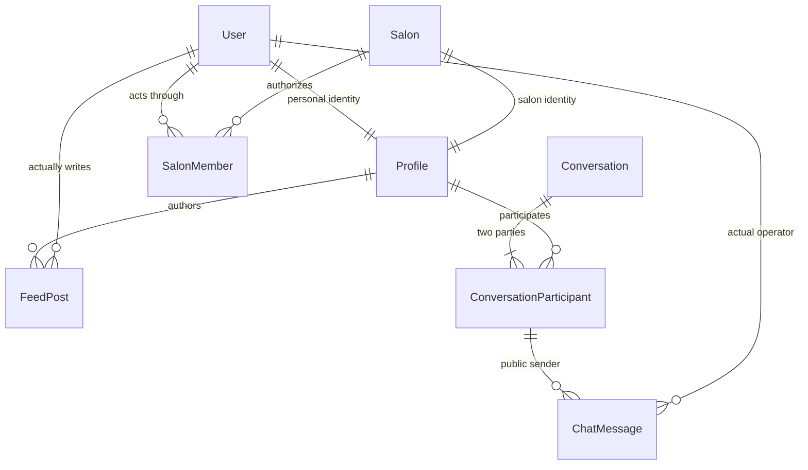

# Profile-first database design

Status: the target schema now lives in `packages/db/prisma/` and is loaded by
`packages/db/prisma.config.ts`. Custom auth is preserved. Application implementation
and the configured database are unchanged; the application still needs alignment
before deploying this schema.

Reviewed migration plans live in `packages/db/migration-plans/`, deliberately
outside the automatically deployed migration directory. Do not apply these plans
until the matching application changes are implemented and tested.

Reference inspected read-only: Klakar frontend `prisma/schema.prisma`, especially
User, Profile, ProfileMember and Account. Nikharta Roop keeps its salon domain and
existing custom password hashing/refresh rotation rather than copying Klakar's
entire model or auth framework.

## Registration contract

The password signup request is **name, email, password**. In one transaction:
insert User with normalized email, let the database provision its Personal Profile,
set Profile.displayName from name and allocate a name-based slug, then insert the
credentials Account with the password hash. Plaintext passwords are never stored.
A rollback removes all of these records. Display fields are not duplicated on User.

Profile.displayName can be null at storage level for existing invited/social
accounts without a name. Password registration must require the supplied name;
nullable storage is not permission to omit validation. OAuth/OIDC identities stay
separate Account rows linked to the same User. No Better Auth migration is included.

## Model responsibilities

| Model | Owns |
| --- | --- |
| `User` | Login identity, email/phone, verification flags, platform role, account deletion |
| `Account` | Password credential or external provider identity; optional validated OIDC issuer |
| `RefreshToken`, `Otp` | Existing custom session rotation and verification secrets |
| `ProfileOnboarding` | Per-profile pending/progress/completed state and resumable draft |
| `Profile` | Public identity, lifecycle, displayName, slug, avatar, cover image, rich bio, optional personal coordinates |
| `UserOnboarding` | Account intent, onboarding completion, partner eligibility and consent history |
| `LoyaltyWallet` | A person's spendable points; existing `LoyaltyTransaction` remains the ledger |
| `Salon` | Booking business, physical location, catalogue, working hours and verification |
| `SalonMember` | A User's current authority to operate a Salon; no duplicate membership system |

`User` no longer stores public display fields, onboarding fields, or points in
the target design. `Profile` is the main identity used by feed and chat. Existing
booking/customer foreign keys remain intact; their public display data joins
through the person's Profile.

There is exactly one Personal Profile per User and one Salon Profile per Salon.
Profile ownership cannot be reassigned. Personal and Salon are identity types,
not login roles. Names may initially be null for invitations or providers that
do not supply them; fake names/emails are never generated.



## Automatic identity creation

Database triggers provision Personal Profile, default onboarding state and an
empty wallet inside every new User insertion transaction. This covers password
registration, OAuth, staff invitations, imports and direct SQL consistently.
Creating a Salon similarly provisions its Salon Profile. If the surrounding
transaction rolls back, the identity rows roll back too.

Future registration code inserts User, then updates the automatically created
Profile in the same transaction. It must not also perform a nested Profile
creation. A deferred constraint prevents an active User from losing their
Personal Profile. Auth/business account deletion policies remain authoritative;
Profile status controls public identity availability independently of account and salon lifecycle.

Salon public displayName, slug, avatar/cover and short bio are also canonical on Profile.
Salon retains its operational address, coordinates, detailed listing description
and gallery. Existing member-specific professional names/titles remain contextual
staff information, not separate login identities.

## Roles and provider identities

- Platform roles: `ADMIN`, `CONTENT_ADMIN`, `USER`.
- Salon roles: `OWNER`, `MANAGER`, `STAFF`.
- Profile types: `PERSONAL`, `SALON`.
- Feed states: `DRAFT`, `PUBLISHED`, `ARCHIVED`, `REMOVED`.

`SUPER_ADMIN` is absent from the target enum; its existing accounts migrate to
`ADMIN`. Platform roles do not grant salon membership. Content admins perform
editorial work; future permission code must preserve this separation.

Provider keys remain strings so adding an OAuth/OIDC provider does not require
an enum migration. `(provider, providerUserId)` remains unique. An OIDC provider
key must identify one immutable, validated issuer; never reuse it for a different
issuer. Provider access/refresh token storage is not added for sign-in alone.
Existing password hashes, provider subjects and hashed refresh tokens survive.

## Feed and chat

- Feed posts, comments and likes belong to Profile. Each write also records the
  actual User for audit. A Salon receives one like per Profile, not per employee.
- Media uses explicit join tables with foreign keys and ordered positions.
  Existing Cloudinary assets are reused; legacy attachment fields remain intact.
- Direct conversations use a sorted, unique pair of Profile IDs. Reverse/self
  pairs and reassignment are rejected. Create the conversation and both
  participant rows in one transaction. Group chat is outside this first design.
- A message sender must be a party to that conversation. `sentByUserId` preserves
  the operator even after their SalonMember record is removed.
- Message retry keys are unique per conversation and actual sender. APIs must
  verify that a repeated key has the same payload before returning an old result.
- Replies and read cursors cannot reference another thread/post. Read cursors
  belong to `(conversation, acting Profile, User)` so staff read progress is separate.
- Deferred constraints enforce text-or-media at commit for live messages and
  published posts. Attachment writes must share the content transaction. Parent
  row locks serialize concurrent attachment removals.
- Referenced history uses restrictive foreign keys and soft deletion, preventing
  accidental cascades through conversations, authorship or verification records.

These are storage invariants, not complete session authorization. The profile-action candidate also validates supplied operator/profile pairs for guarded writes. Future services must
derive the User from the authenticated session and recheck current ownership or
SalonMember permissions on every read/write. A Profile ID supplied by a client
is not permission. Raw Profile queries must not expose private location or auth
relations. Removed staff retain historical attribution, not access to salon chats.

## Migration candidates and rollout

1. `20261026060000_simplify_platform_roles`: map old administrators and replace
   the platform enum, preserving account/session records.
2. `20261026061000_identity_feed_chat`: add the models, constraints, expiry indexes,
   provisioning triggers and backfill. Copy existing display fields, consent
   values and balances exactly; historical timestamps are not invented.
3. `20261026062000_profile_primary_contract`: compare old/new records under table
   locks and refuse cleanup if any backfill is stale or missing. Only then remove
   duplicated User/Salon columns.

4. `20261026063000_rich_content_and_slugs`: preserve existing Salon URLs on the
   Salon Profile, allocate Personal Profile slugs, add independent public slugs,
   and cast existing serialized JSON to native JSONB without dropping its contents.
   Invalid JSON aborts the transaction; it is not silently replaced or discarded.

**Do not apply these candidates to the current app.** Application queries,
permissions, registration/profile writes and wallet transactions must first be
adapted and tested as a separate implementation task. These candidates are not
an online rolling-deployment plan: pause writes and coordinate the matching app
release. Role changes may require access-token refresh. Audit existing coordinate
pairs and negative balances before rollout; constraints reject invalid data.

The existing onboarding completion flag is moved unchanged rather than deriving
unknown history from timestamps. Consolidating that legacy flag needs a separate
data audit. The previous refund and loyalty idempotency findings also remain
separate implementation work; this design does not claim to fix them.

## Verification

From the repository root:

```sh
pnpm db:validate
SCHEMA_TEST_DATABASE_URL='postgresql://LOCAL_TEST_DATABASE' pnpm --filter @nikharta-roop/db test:schema
```

The schema test requires an explicit local URL, never loads the application env,
creates an isolated schema, applies historical plus candidate migrations and
drops its schema afterward. It checks data preservation, automatic provisioning,
rollback, role conversion, identity ownership, content constraints, retry keys,
reply boundaries and per-staff read cursors. It does not test future API/UI behavior.

## Rich content and public routes

`ContentFormat` is `TEXT | HTML | JSON`. Profile has bio/bioHtml/bioJson;
feed posts, comments and messages have body/bodyHtml/bodyJson; blog and catalogue
content retain their text/HTML/document fields with native Prisma Json storage.
The format field identifies the authoritative representation; other fields are
render/search projections. APIs must validate editor documents and sanitize HTML.
Storage support does not make raw HTML safe to render.

Public routes resolve slugs only, for example:

- `/profiles/:profileSlug`
- `/salons/:salonProfileSlug/services/:serviceSlug`
- `/salons/:salonProfileSlug/staff/:staffSlug`
- `/profiles/:profileSlug/posts/:postSlug`
- `/appointments/:bookingSlug`
- `/chat/:conversationSlug/messages/:messageSlug`

Profile slugs are globally unique. Services/products/packages and staff slugs are
scoped to their salon; lookups must include that parent. Booking, chat and other
private references use independent random slugs, never raw database IDs or email
addresses. Internal primary/foreign keys remain IDs so display-name changes do
not rewrite relationships. Existing Salon.slug is transferred to its Profile;
Salon no longer duplicates the canonical slug.

Slug-based routing is not authorization. Private resources still require the
current User/Profile permissions. New slugs must pass shape/reserved-name checks.
Name changes must not automatically change slugs; user-facing slug renames need
an explicit redirect/history policy before that capability is exposed. Current
application route handlers have not yet been migrated to this contract.


## Account access, draft profiles and OTP purposes

Candidate `20261026064000_account_and_profile_onboarding` extends the target design;
it is not deployed to the configured database.

- User starts `PENDING_VERIFICATION`. Explicit account activation changes it to
  `ACTIVE` after email or phone verification; `SUSPENDED` blocks account access.
  The database rejects an ACTIVE user with neither identifier verified. Verification
  flags alone do not automatically activate or unsuspend a user. Soft deletion
  remains independently authoritative. Existing non-deleted verified users are
  backfilled ACTIVE; other users retain the pending default.
- Both PERSONAL and SALON profiles start `DRAFT`. Creating or verifying a User
  never activates either profile. A newly created Salon also retains its existing
  DRAFT default. Existing profile records are conservatively backfilled DRAFT;
  rollout must explicitly review their activation rather than infer completion.
- Each new Profile automatically receives a `ProfileOnboarding` row in the same
  transaction. Its primary key is profileId, preventing duplicate progress.
  Status is PENDING, IN_PROGRESS or COMPLETED, with optional currentStep and JSON
  draft. COMPLETED requires completedAt; other states require it to be null.
  Step keys are validated according to the profile type by the future service.
- ACTIVE profiles require completed profile onboarding at transaction commit.
  Completion does not automatically activate a profile or make a Salon LIVE.
  Profile suspension/archive, salon verification, salon availability and account
  suspension remain separate decisions. Existing identity creation triggers also
  provision profile onboarding through the new Profile insertion trigger.
- UserOnboarding retains legacy completion/consent fields unchanged and gains
  currentStep, draft and updatedAt for resumable account onboarding. Account
  onboarding completion is independent of both login access and profile completion.
- OTP purposes are REGISTRATION_VERIFICATION, LOGIN, EMAIL_VERIFICATION,
  PHONE_VERIFICATION and PASSWORD_RESET. Channel (EMAIL, PHONE, WHATSAPP) describes
  delivery, not intent. Legacy purposes and the existing default are preserved.
  Future issuance should explicitly select the purpose; verification must match
  user, channel and purpose and atomically consume an unexpired code. A LOGIN OTP
  must not change verification or suspension state as a side effect. Registration
  verification may verify the matching identifier and activate an eligible pending
  account in the same transaction, without completing onboarding.
- Existing codeHash, expiresAt, attempts/maxAttempts and isUsed remain. Optional
  usedAt records future consumption time; unknown historical times stay null.
  A non-null usedAt requires isUsed=true. Expiry and attempt enforcement still
  require atomic verification logic; purpose enums alone do not enforce it.

The lifecycle candidate is followed by
`20261026065000_profile_action_guards`, which adds the following storage rules:

- Every surviving Profile must retain its onboarding row, including DRAFT profiles.
  Deferred validation permits deleting/replacing an onboarding row within one
  transaction, but rejects a missing row at commit. Onboarding mutations lock the
  parent Profile before changing progress, serializing them with activation.
- Public actions require an ACTIVE, non-deleted User and ACTIVE acting Profile.
  Owned feed/blog drafts can be saved while the Profile is DRAFT. SUSPENDED and
  ARCHIVED profiles cannot write, even drafts. Personal profiles must belong to
  the supplied operator; salon profiles require a current SalonMember and a
  non-deleted, non-archived Salon. No platform-role bypass is implicit.
- Guards cover feed posts/comments/likes, chat messages/read cursors, favorites,
  service/product reviews and blog posts/comments on INSERT and UPDATE. Existing
  attribution cannot be reassigned. The original operator remains stored after
  staff membership removal, but that former member cannot perform new guarded
  writes. Current members can act for salon profiles; finer OWNER/MANAGER/STAFF
  action permissions remain a service-level contract.
- Favorite, ServiceReview, ProductReview, BlogPost and BlogComment gain required
  actorProfileId foreign keys. Existing User foreign keys remain for attribution.
  Legacy rows backfill the corresponding PERSONAL Profile without inventing
  another operator. Favorite/review uniqueness uses the profile identity;
  favorites and customer reviews require PERSONAL actors. Blog actors may be
  PERSONAL or SALON with the matching operator. No legacy rows are removed.
- Salon address/city/state/zip and coordinates become nullable for incomplete
  drafts. New salons default isActive=false and an empty gallery. LIVE requires
  nonblank address fields, valid coordinates, isActive=true and no deletion.
  Existing isActive values are preserved. Partial/out-of-range coordinate pairs
  are rejected. Existing invalid LIVE data aborts this candidate for review rather
  than being silently changed. Verification and profile activation remain separate.

Operator/profile reads take row locks so account suspension, profile changes and
membership removal cannot race a successful guarded write. This follows the
[PostgreSQL row-locking contract](https://www.postgresql.org/docs/current/explicit-locking.html).
Deadlocks/serialization failures must be retried by future transaction callers.

These guards verify supplied attribution, not the identity of a SQL connection.
The trusted API must obtain the operator from its authenticated session and must
still authorize reads, deletes, attachment mutations, moderation and operational
salon actions. No RLS/session boundary is introduced. Historical author fields
are not evidence that the current caller may edit a row; moderation by a different
operator needs an explicit audited API contract rather than rewriting authorship.
Appointments and financial/customer records retain their existing User relations;
this candidate does not redesign booking ownership, payments or staff workflows.

Additional regression checks cover draft publishing, operator mismatch, suspension,
removed staff, draft onboarding deletion, incomplete Salon creation, LIVE field
validation, legacy actor backfill, personal-only reviews/favorites and concurrent
membership revocation.
